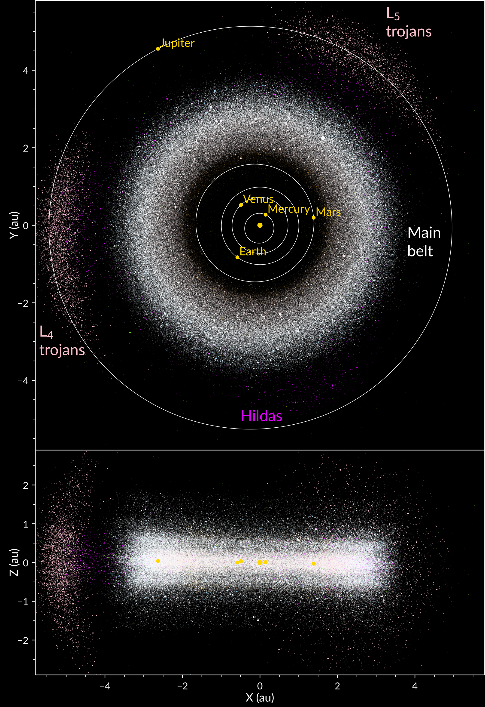
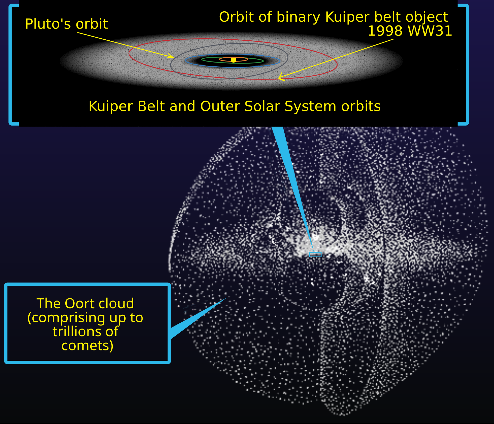

<nav class="packet-nav" aria-label="Packet navigation">
<a href="/aa/ss/2026-2027/">AA:SS class page</a>
<a href="/aa/assignments/ss_solar_system_1.zip">Download assignment (.zip)</a>
<a href="/">Home</a>
</nav>

The solar system consists of the titular star, the 8 planets **Mercury**, **Venus**, **Earth**, **Mars**, **Jupiter**, **Saturn**, **Uranus**, and **Neptune**. In between Mars and Jupiter we find the **asteroid belt**, and beyond Neptune there is the **Kuiper belt**.

> ### Problem 1
>
> The mean distance between the **Sun** and the Earth is approximately 1 AU. This is about 150 million kilometers. How many seconds does it take for the light emitted by the Sun to reach us?


Below is a collection of astrophysical data for the 8 solar system planets.

::: {.table-responsive role="region" aria-label="Data table" tabindex="0"}

|  | Mercury | Venus | Earth | Mars | Jupiter | Saturn | Uranus | Neptune |
| :---: | :---: | :---: | :---: | :---: | :---: | :---: | :---: | :---: |
| $M$ ($M_\oplus$) | 0.055 | 0.82 | 1 | 0.11 | 318 | 95 | 15 | 17 |
| $R$ ($R_\oplus$) | 0.38 | 0.95 | 1 | 0.53 | 11.2 | 9.5 | 4.0 | 3.9 |
| $\rho$  ($g/cm^3$) | 5.4 | 5.2 | 5.5 | 3.9 | 1.3 | 0.7 | 1.3 | 1.6 |
| $a$ (AU) | 0.39 | 0.72 | 1 | 1.52 | 5.2 | 9.5 | 19.2 | 30.1 |
| $e$ | 0.21 | 0.01 | 0.02 | 0.09 | 0.05 | 0.05 | 0.05 | 0.01 |
| $P$ (yr) | 0.25 | 0.62 | 1 | 1.9 | 11.9 | 29.4 | 84 | 164 |

:::

> Table 1: Physical data of the planets relative to the Earth’s mass $M_\oplus=6.0\times 10^{24}\ kg$, radius $R_\oplus=6400\ km$, and orbital radius 1 AU $=$ $1.5\times 10^8\ km$. Here, $\rho$ is the mass density (expressed in the customary non-SI units of grams per cubic centimeter), $a$ is the length of the orbit's semimajor axis, $e$ is the orbital eccentricity, and $P$ denotes the orbital period.


> ### Problem 2
>
> Make a scale model showing the distances of the planets from the Sun.

> ### Problem 3
>
> Make a scale model of the sizes of the planets.

> ### Problem 4
>
> Is it feasible to make a model that accurately represents the scales of the sizes and the distances simultaneously? If so, please make one. If not, why not?

> ### Problem 5
>
> The 8 planets split into two groups using the physical features described in the table. Describe your splitting by referring explicitly to the concepts of size, mass, density $\rho$, and proximity to the Sun. The members of these two groups are referred to as **terrestrial** or **Jovian**. Explain why you think that is.

The terrestrial planets have some further similarities and differences. Mars has a much thinner **atmosphere** than Earth, while Venus has a much thicker and hotter atmosphere. Mercury has only a tenuous **exosphere**. Among the planets, Earth uniquely has an oxygen-rich atmosphere and persistent bodies of liquid water on its surface. Earth and Mars have moons, but Mercury and Venus do not. Earth and Mercury have **magnetospheres** associated with their intrinsic magnetic fields, with Mercury’s field much weaker than Earth’s. Venus and Mars lack present-day global intrinsic magnetic fields, but both have induced magnetospheres. Earth and Mars spin at (almost) the same rate, but Mercury and Venus spin much more slowly, and Venus even spins in the opposite direction (**retrograde**).

> ### Problem 6
>
> Add up the masses of all the terrestrial planets except Earth and compare the result to the mass of the Earth.

> ### Problem 7
>
> Add up the masses of all the planets except Jupiter and compare it to the mass of Jupiter.

> ### Problem 8
>
> By what factor is the mass of the Sun larger than the sum of the masses of all the planets? What percentage of the mass of the solar system is accounted for by the Sun alone?

As you just calculated, about 99.9% of the mass of the solar system resides in the Sun. The eight planets are evenly split between the **terrestrial planets**, or rocky planets, and the giant planets: Jupiter and Saturn are **gas giants**, while Uranus and Neptune are **ice giants**. The rocky planets have orbital semimajor axes ranging from about 0.39 to 1.52 AU; those of the giant planets range from about 5.2 to 30 AU.

## Asteroids

Between Mars and Jupiter lies the **main asteroid belt**, whose members mostly have orbital semimajor axes between about 2.1 and 3.3 AU. These bodies contain varying proportions of rock, metal, and carbon-rich material; some also contain substantial water ice. Together, they have a mass of roughly $2.4\times10^{21}$ kg, only about 3% of the mass of the Moon.

The belt is an example of a **circumstellar disk**—“circumstellar” means “star-surrounding.” Its members follow eccentric and inclined orbits, giving the population a broad, donut-like shape. The actual belt has neither a sharp boundary nor a uniform distribution of material.



The main belt is estimated to contain roughly one to two million asteroids larger than 1 km in diameter, with many more smaller bodies. Nevertheless, it is overwhelmingly empty space: a spacecraft passing through it is very unlikely to collide with a large asteroid. Numerous missions have crossed the belt safely on their way to the outer solar system. Any estimate of the typical separation between bodies must specify how small a body is included in the count.

The four largest members of the main asteroid belt are [(Vernazza et al. (2021), Table 1)](https://www.eso.org/public/archives/releases/sciencepapers/eso2114/eso2114a.pdf)
:

::: {.table-responsive role="region" aria-label="Data table" tabindex="0"}

| Body | Approximate mean diameter (km) | Approximate mass (kg) | Mass relative to Ceres |
|:-----|------------------------------:|---------------------:|----------------------:|
| **Ceres** (dwarf planet) | 940 | $9.4\times10^{20}$ | 1.00 |
| **Vesta** | 520 | $2.6\times10^{20}$ | 0.28 |
| **Pallas** | 510 | $2.0\times10^{20}$ | 0.22 |
| **Hygiea** | 430 | $8.7\times10^{19}$ | 0.093 |

:::

These rounded diameters describe equivalent-volume spheres; the bodies themselves are not all spherical. Mass ratios were calculated before rounding.

Ceres alone contains roughly 40% of the belt’s mass. Thus, although small bodies dominate the population numerically, a few large bodies contain much of its mass.

Jupiter’s gravitational influence helped shape the asteroid belt and inhibit planetary growth there. The belt’s present population also reflects collisions and changes in asteroid orbits that carried material out of the belt. Such orbital changes can result from the accumulated gravitational influence of planets, even without close encounters.

## Beyond Neptune

Beyond Neptune lies the **Kuiper belt**, whose main region extends from roughly 30 to 50 AU. Its members contain rock and volatile ices. The largest familiar example is **Pluto**, about 2,380 km in diameter—roughly 2.5 times Ceres’s diameter (but still only about $0.68 \approx 2/3$ the size of the Moon). Other large members include Haumea ($1.7 \times$ Ceres), Makemake ($1.5 \times$), Quaoar ($1.2  \times$), and Orcus (approximately the same size as Ceres).

Kuiper-belt objects belong to the broader population of **trans-Neptunian objects** (TNOs). Other TNO populations include scattered and detached objects, many of which follow highly elongated orbits extending far beyond the main Kuiper belt. These populations do not form a simple sequence of separate concentric rings.

Much farther away, the proposed **Oort cloud** provides a reservoir for long-period comets such as [Hale–Bopp](https://en.wikipedia.org/wiki/Comet_Hale%E2%80%93Bopp) and [Tsuchinshan–ATLAS](https://en.wikipedia.org/wiki/Comet_Tsuchinshan%E2%80%93ATLAS). Its boundaries are uncertain: estimates place its inner region a few thousand AU from the Sun and its outer extent at tens of thousands to about 100,000 AU. Its outer population is thought to be approximately spherical. Gravitational perturbations can send members into the inner solar system, replenishing the observable comet population as other comets fade, fragment, or are ejected.



Sources: [ESA: Small objects in the Solar System](https://www.esa.int/ESA_Multimedia/Images/2023/11/Small_objects_in_the_Solar_System); [NASA: Asteroid facts](https://science.nasa.gov/solar-system/asteroids/facts/); [NASA: Asteroid fact sheet](https://nssdc.gsfc.nasa.gov/planetary/factsheet/asteroidfact.html); [Vernazza et al. (2021): Asteroid sizes and shapes](https://orbi.uliege.be/bitstream/2268/264380/1/aa41781-21.pdf); [NASA: Kuiper belt facts](https://science.nasa.gov/solar-system/kuiper-belt/facts/); [NASA: Pluto facts](https://science.nasa.gov/dwarf-planets/pluto/facts/); [NASA: Oort cloud facts](https://science.nasa.gov/solar-system/oort-cloud/facts/).

> ### Problem 9
>
> Pluto's orbit has a semimajor axis $a\approx39.5\ \mathrm{AU}$ and eccentricity $e\approx0.25$.
>
> a. Calculate its **perihelion** and **aphelion** distances. Hint: draw the ellipse and mark the distance $ea$ from its center to the Sun.
>
> b. Sketch Pluto's ellipse with the Sun at one focus, labeling the two apside distances. Compare these distances with Neptune's nearly circular orbital radius of about 30 AU and the main Kuiper belt's approximate 30–50 AU extent. Is Pluto always farther from the Sun than Neptune?
>
> c. **Optional.** Suppose you were given only the two apside distances. How could you recover $a$ and $e$? Check your formulas using your answers from part a.
>
> This sketch compares distances from the Sun. It does not determine whether Pluto and Neptune can encounter one another.


> ### Problem 10: Small worlds, reusable calculations
>
> Ceres, Vesta, Pallas, and Hygiea are the four largest bodies in the main asteroid belt. Beyond Neptune, Pluto, Haumea, Makemake, Quaoar, and Orcus give us another group of worlds to compare. How small are they compared with our Moon, and what would gravity be like at their surfaces?
>
> We could repeat each calculation by hand. Instead, we will write Python functions and apply them to a collection of data. Use LaTeX when explaining the mathematics in your written answers.
>
> #### 10a. A worked example: diameter in Moon units
>
> The Moon's diameter is about $3475\ \mathrm{km}$; Pluto's is about $2380\ \mathrm{km}$. Their diameter ratio is $2380/3475\approx0.685$. The function below performs that division for any diameter supplied in kilometers.
>
> Run the cell. The line beginning with `def` defines the function; its input is `diameter_km`. The indented `return` line supplies the result. The function definition alone does not calculate Pluto's ratio: the last line calls the function with Pluto's diameter.

```python
MOON_DIAMETER_KM = 3475
MOON_MASS_KG = 7.35e22
G = 6.67430e-11  # m^3 / (kg s^2)

def diameter_in_moons(diameter_km):
    return diameter_km / MOON_DIAMETER_KM

print(diameter_in_moons(2380))
```

> Call the function for the Moon and for Ceres (diameter 940 km). Predict the Moon's result before running the cell. Why does the returned ratio have no units?

```python
# Call diameter_in_moons for the Moon and Ceres.
```

> #### 10b. Mass in Moon units
>
> Write `mass_in_moons(mass_kg)` by adapting the diameter function. Use Pluto's mass, $1.30\times10^{22}\ \mathrm{kg}$, to check your work: its mass is about 0.177 Moon masses. Also check that the Moon returns 1.
>
> In Python, `1.30e22` means $1.30\times10^{22}$.
>
> `pass` is a placeholder that lets Python define an unfinished function. Replace it with your calculation and a `return` statement; until then, the function returns `None`.

```python
def mass_in_moons(mass_kg):
    # Replace pass with a return statement for the mass in Moon units.
    pass

# Add calls to check Pluto and the Moon.
```

> #### 10c. Surface gravity: two inputs
>
> Recall $g=GM/R^2$. Write `surface_gravity(mass_kg, diameter_km)` to return $g$ in $\mathrm{m/s^2}$. This function needs both the mass and the diameter.
>
> First calculate `radius_m`: divide the diameter by 2 and convert kilometers to meters. Then calculate and return $g$. Python uses `**2` for squaring.
>
> Test the function using the Moon's mass and diameter. You should obtain about $1.62\ \mathrm{m/s^2}$.

```python
def surface_gravity(mass_kg, diameter_km):
    # Convert diameter_km to radius_m, then return g in m/s^2.
    pass

# Add a call to check the Moon.
```

> #### 10d. Escape speed
>
> Recall $v_{\mathrm{esc}}=\sqrt{2GM/R}$. Write `escape_speed(mass_kg, diameter_km)` to return the escape speed in **kilometers per second**. Reuse your radius conversion. You can take a square root with `**0.5`; the result calculated using SI units is in meters per second, so divide by 1000 before returning it.
>
> Check the Moon: the result should be about $2.38\ \mathrm{km/s}$.
>
> For these calculations, model each body as an isolated sphere and ignore rotation. Haumea is especially elongated: its diameter here represents a sphere of equal volume. Its calculated gravity and escape speed characterize that spherical model, not every point on the real surface.

```python
def escape_speed(mass_kg, diameter_km):
    # Convert diameter_km to radius_m, then return escape speed in km/s.
    pass

# Add a call to check the Moon.
```

> #### 10e. Keeping related data together
>
> A **dictionary** associates a key with a value. Here the keys are the labels `"diameter_km"` and `"mass_kg"`. Run this example. Notice how square brackets retrieve a value by its key.

```python
pluto = {"diameter_km": 2380, "mass_kg": 1.30e22}
print(pluto["diameter_km"])
print(diameter_in_moons(pluto["diameter_km"]))
```

> Use the entries in `pluto` to call your surface-gravity and escape-speed functions. Do not type its diameter and mass again.

```python
# Use pluto to calculate its surface gravity and escape speed.
```

> We can now make a dictionary of bodies. Each name is a key whose value is another dictionary, containing that body's data. Run the cell below.
>
> The numbers are rounded for this exercise. Makemake's adopted mass is a preliminary estimate from its satellite's orbit, treating the satellite's mass as negligible. More precise results would need uncertainties and better shape models.

```python
bodies = {
    "Moon":     {"diameter_km": 3475, "mass_kg": 7.35e22},
    "Ceres":    {"diameter_km": 940,  "mass_kg": 9.4e20},
    "Vesta":    {"diameter_km": 523,  "mass_kg": 2.6e20},
    "Pallas":   {"diameter_km": 511,  "mass_kg": 2.0e20},
    "Hygiea":   {"diameter_km": 433,  "mass_kg": 8.7e19},
    "Pluto":    {"diameter_km": 2380, "mass_kg": 1.30e22},
    "Haumea":   {"diameter_km": 1600, "mass_kg": 4.0e21},
    "Makemake": {"diameter_km": 1430, "mass_kg": 2.7e21},
    "Quaoar":   {"diameter_km": 1100, "mass_kg": 1.2e21},
    "Orcus":    {"diameter_km": 910,  "mass_kg": 5.5e20},
}

print(bodies["Pluto"]["diameter_km"])
```

> #### 10f. Repeating a calculation with a loop
>
> A **list** stores a sequence of values. The first line below makes a short list of names. The `for` loop assigns each name to `name` in turn and runs the indented line for it. Run this example.

```python
names = ["Ceres", "Pluto", "Moon"]
for name in names:
    print(name, diameter_in_moons(bodies[name]["diameter_km"]))
```

> To visit every entry, use `bodies.items()`. On each pass, `name` is an object's name and `body` is its data dictionary. Run this version, then extend it to print each name **and its diameter in Moon units**. Call your existing function inside the loop.

```python
for name, body in bodies.items():
    print(name)  # Add the diameter in Moon units here.
```

> #### 10g. A comparison table
>
> The following code handles the formatting for you. It calls your four functions for every object and prints the results in aligned columns. Complete and run your functions first, then run this cell.
>
> The expressions inside braces insert values into strings. `^12.3f` centers a number in a 12-character column with three digits after the decimal point; it does not change the stored value or imply that our data are accurate to that precision. You do not need to reproduce this formatting code from memory.
>
> If a function still contains only `pass`, this cell prints a reminder instead of the table. Complete the function, rerun its definition cell, and try again.

```python
# These checks detect the None returned by an unfinished pass function.
if (mass_in_moons(MOON_MASS_KG) is None
        or surface_gravity(MOON_MASS_KG, MOON_DIAMETER_KM) is None
        or escape_speed(MOON_MASS_KG, MOON_DIAMETER_KM) is None):
    print("Complete the functions in 10b–10d and rerun their cells, then run this table again.")
else:
    print(f"\n {'Body':^10} | {'D / D_moon':^12} | {'M / M_moon':^12} | {'g (m/s^2)':^12} | {'v_esc (km/s)':^14}")
    print('-' * 74)
    for name, body in bodies.items():
        d = body['diameter_km']
        m = body['mass_kg']
        relative_diameter = diameter_in_moons(d)
        relative_mass = mass_in_moons(m)
        g = surface_gravity(m, d)
        v_esc = escape_speed(m, d)
        print(f" {name:^10} | {relative_diameter:^12.3f} | {relative_mass:^12.4f} | {g:^12.3f} | {v_esc:^14.3f}")
    print('')
```

> #### 10h. What do the results tell us?
>
> 1. Which listed body is closest to Ceres in diameter? Compare their masses and surface gravities. Does nearly equal size imply equal mass?
>
> 2. Pluto's diameter is about 0.685 Moon diameters. Is its mass also about 0.685 Moon masses? For spheres, volume scales as diameter cubed. Use this fact to explain why diameter and mass ratios need not agree, even before allowing for different densities.
>
> 3. **Optional.** If two spherical bodies have the same surface gravity but different radii, must they have the same escape speed? Combine your formulas to express escape speed in terms of $g$ and $R$.
>
> 4. Suppose a better diameter measurement becomes available for Orcus. Where would you edit the notebook? Which cells would you rerun to update the table?
