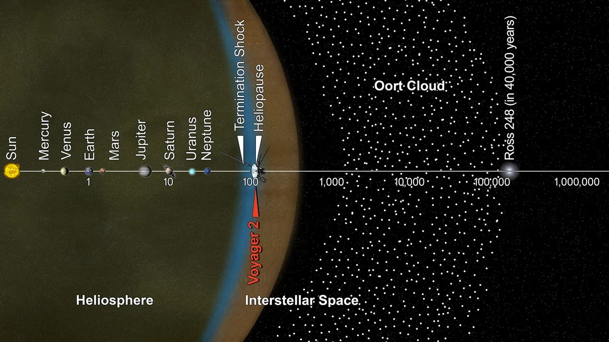
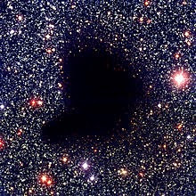
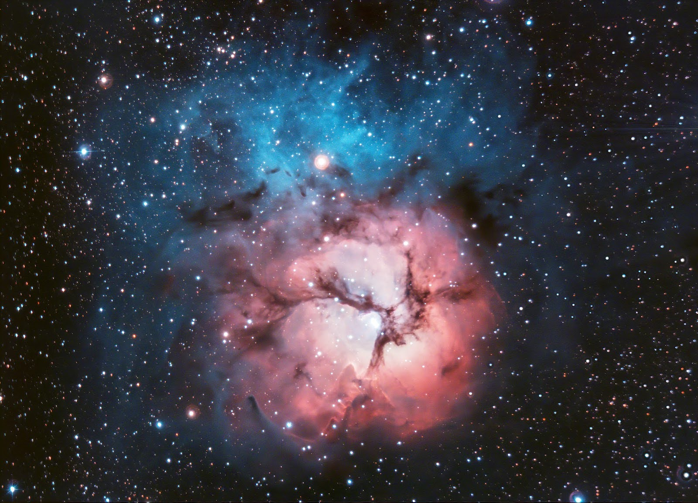

<nav class="packet-nav" aria-label="Packet navigation">
<a href="/aa/ss/2026-2027/">AA:SS class page</a>
<a href="/aa/assignments/ss_solar_system_2.zip">Download assignment (.zip)</a>
<a href="/">Home</a>
</nav>

**Reading:** [Astronomy 2e §21.1, Star Formation](https://openstax.org/books/astronomy-2e/pages/21-1-star-formation), beginning with “Molecular Clouds: Stellar Nurseries.” The calculations below supply our quantitative model. You do not need to follow the book’s links to other chapters.

In this packet we follow the material from a molecular cloud to the formation of separate collapsing regions. Solar System III will follow our protosun and its surrounding disk.

In Solar System I, we studied the structure of the solar system. Our findings are summarized neatly in the following diagram:\

Notice that the [scale is logarithmic](https://en.wikipedia.org/wiki/Logarithmic_scale). This means that instead of intervals on the (horizontal axis) increasing linearly, they are increasing exponentially: $1=10^0$, $10=10^1$, $100=10^2$, $\dots$

In this packet, we will begin to explore the standard paradigm for the formation of the solar system called the **nebular hypothesis**. This hypothesis was originally advocated in 1755 by [Immanuel Kant](https://en.wikipedia.org/wiki/Immanuel_Kant) and developed scientifically by [Pierre Simon de Laplace](https://en.wikipedia.org/wiki/Pierre-Simon_Laplace) in 1796\. In the modern version of this hypothesis, the solar system formed from a dense region within an enormous cloud of gas and dust that collapsed due to the gravitational attraction between the particles in the cloud. How small a region, and how large a cloud? Dense cores that form low-mass stars have characteristic sizes of order 0.1 pc (about 0.3 lightyears) and masses of order one to a few solar masses.[^2] Their parent molecular clouds can contain tens of thousands to millions of solar masses and extend over tens to hundreds of lightyears. For comparison, our model GMC below has a mass of $10^5 M_\odot$ and a diameter of 40 pc, about 130 lightyears. These give us the scale of the contrast; they are not measurements of the Sun's particular birth cloud. Some core material can be lost or remain outside the forming star.

Let’s step through the ingredients and the physics one concept at a time.

# Interstellar Matter, Nebulae, and Molecular Clouds

The space between stars is not entirely empty. Stars can have their own versions of solar systems. The planetary regions of these systems are relatively modest in extent compared to the distances between neighboring stars; distant reservoirs such as our Oort cloud extend much farther.\

> ### Problem 1
>
> `ss_solar_system_1` found that the Sun contains nearly all the mass of our solar system. Let's start with the material available to build it. In a sample of cloud gas, 91 of every 100 nuclei are hydrogen and 9 are helium. Take one hydrogen nucleus as one mass unit and one helium nucleus as four. Ignore dust and electron masses in this estimate.
>
> a. How much mass do the 91 hydrogen nuclei contribute? How much do the 9 helium nuclei contribute? Use those masses to find the percentage of the total gas mass contributed by each element.
>
> b. Suppose two clouds each contain 9% helium. One percentage was measured by counting nuclei and the other by counting their mass. Which cloud has the greater fraction of helium nuclei? Explain how you know.

We call the stuff between the star systems the **interstellar medium (ISM)**. The interstellar medium consists of radiation (a.k.a. light) and interstellar matter. Interstellar matter, in turn, is mostly gas and dust. The gas can be **ionized**, **atomic**, or **molecular**. Far and away the most significant components are atomic hydrogen (neutral or ionized), helium (neutral or ionized), and molecular hydrogen H2. In addition to this, there are much smaller amounts of carbon, oxygen, and nitrogen. A region of concentration of ISM is called a **nebula**. Some nebulae like [Barnard 68](https://en.wikipedia.org/wiki/Barnard_68) below are so dense that they block all the light coming from the stars behind them.

Such **dark nebulae** look like holes in the sky, but you can see the reddening of the stars around the edge before the dust gets so dense that all the visible light is blocked.

Others are bright because they are illuminated by nearby stars like the [Trifid Nebula](https://en.wikipedia.org/wiki/Trifid_Nebula) below.

The solar system formed in a **molecular cloud**. Their cold gas is often at temperatures of 10–20 K. Densities vary enormously between the cloud as a whole and its dense interior regions. Take dust to be about 1% of the cloud’s mass. How closely does the gas in Problem 1 resemble the material that formed our solar system? If we count only hydrogen and helium nuclei in the **solar nebula**, we estimate that about 91 out of every 100 were hydrogen and 9 were helium. By mass, the solar nebula was about 71% hydrogen, 27% helium, and 1.5% heavier elements. Problem 1 counts only hydrogen and helium, so its mass percentages use a slightly different denominator.[^1]

Jupiter gathered gas from this same solar nebula. In the atmosphere sampled by the [Galileo probe](https://doi.org/10.1029/98JE00695), roughly 86 of every 100 gas particles were hydrogen *molecules* and 14 were helium atoms. Each H2 molecule contains two hydrogen nuclei, so counting nuclei instead gives about 8 helium nuclei per 100 hydrogen and helium nuclei—close to the 9 in Problem 1.

An enormous molecular cloud is called a **giant molecular cloud**, or **GMC**. For the following bounds exercise, use these illustrative ranges: diameters of 15–600 lightyears and masses of $10^4$–$10^7 M_\odot$. These are illustrative ranges, not a claim that every combination of endpoints occurs in nature; catalogs and definitions give different limits.\
The size of the GMC and its mass are related by the **mass density** (*e.g.*, for a spherical cloud of radius $R$ and mass $M$, $\rho=\frac{3M}{4\pi R^3}$). We will use uniform balls to calculate mean densities. A real cloud is clumpy and filamentary, so the mean need not describe any particular region inside it.

> ### Problem 2
>
> a. Begin with the quoted ranges of GMC masses and diameters. Which pairing of endpoints gives the lowest possible mean density? Which gives the highest? Give your reasoning before calculating. Remember to convert diameter to radius.
>
> b. Now pair small mass with small diameter and large mass with large diameter. Calculate both densities using the same function. Would the ranges alone tell us which pairings actually occur in nature?
>
> c. Consider one model cloud with mass $10^5 M_\odot$ and radius 20 pc, and a region inside it with mass $10^3 M_\odot$ and radius 2 pc. Use $1\ \mathrm{pc}=3.09\times10^{16}\ \mathrm{m}$. Predict the density ratio using only the mass and radius ratios. Then evaluate both densities in g/cm³. How can a region containing so little of the mass be denser than the whole?
>
> d. If you had a catalog of observed clouds, what information would you need from it to replace the bounds in (a) with an observed range of mean densities?

The mass of the GMC comes almost entirely from **protons** and **neutrons**. The proton mass is only a tiny bit smaller than the neutron mass, so for the purpose of accounting for mass, we will treat them as the same and refer only to the mass $m_p\approx 1.7\times 10^{-27}\ kg$ of the proton. In fact, protons and neutrons are so similar that we often lump them together and call them nucleons: A **nucleon** is either a proton or a neutron.

The electron is about 1/1800 of a proton's mass. We can neglect electron masses in this mass inventory, but we must still count free electrons when we count the particles sharing thermal energy.

For thermal motion, we need to know how many independently moving particles share the gas mass. We describe their **mean mass per particle** by $\bar m=\mu m_p$. Thus $\mu$ is dimensionless: it is the average particle mass expressed in proton-mass units. It is often called the **mean molecular weight**, even when some or all of the particles are atoms, ions, or free electrons.

There is an important distinction between particles and degrees of freedom. Each freely moving particle has three translational degrees of freedom, one for motion along each spatial direction. In the classical ideal-gas model, each contributes $k_BT/2$ to the average energy. Thus the total translational kinetic energy is

$$
K_{\rm th}=\frac32 Nk_BT=\frac32\frac{M}{\mu m_p}k_BT.
$$

Here $k_B$ is Boltzmann's constant, which we will discuss below. For a fixed gas mass, $\mu$ tells us how many particles share the translational energy. It is a mass per particle, rather than a mass per degree of freedom. Molecules can also have rotational and vibrational degrees of freedom; those do not enter this translational-energy formula. Free electrons count as particles even though they contribute very little mass.

> ### Problem 3
>
> a. Use the limits in Problem 2 to estimate the number of nucleons in a GMC. Which earlier mass comparison lets you do this?
>
> b. For thermal motion we need the number of freely moving gas particles, $N$. Use $M/N=\mu m_p$, where $M$ is the total gas mass and $m_p$ is the proton mass. Take two hydrogen nuclei. Count the moving particles when they form one molecule, when they are separate neutral atoms, and when they are fully ionized. What is $\mu$ in each case? Count the electrons when they move freely.
>
> c. Return to the mixture in Problem 1. To keep the counts integral, start with 182 hydrogen nuclei and 18 helium nuclei. Find $\mu$ first when the hydrogen is molecular and helium is neutral, then when all the gas is fully ionized. How can the same gas mass give two answers?

# Gravity and Thermal Support

In this section, we will explore the possibility that the solar system formed from the collapse of part of a molecular cloud. For definiteness, continue with the model cloud and interior region in Problem 2c.

What could make this gas collect into a star? Gravity pulls the material together, while gas pressure can help hold it up. We will first look at the energy released when the cloud contracts, then ask whether its thermal motions provide enough support to prevent that contraction. These are related questions, but the energy calculation alone will not settle the support question.

In Astrodynamics II we studied the gravitational potential energy of one body in the field of another. A cloud also has gravitational potential energy because its particles attract one another. For a uniform sphere (a ball of uniform density), with zero energy when all its material is dispersed infinitely far apart,

$$
U=-\frac35\frac{GM^2}{R}.
$$

The dimensions should look familiar. The factor $3/5$ accounts for assembling the sphere a shell at a time. The supplemental material at the end shows where it comes from.

As the cloud shrinks, its material becomes more tightly bound. The gravitational potential energy decreases, and that decrease supplies energy that can go into motion or leave as radiation. In the next problem, keep track of the distinction between the cloud's negative potential energy and the positive amount of energy released. We will return to where that released energy goes when we follow the gas as it contracts.

> ### Problem 4
>
> a. Check the dimensions and explain the negative sign. Calculate $U$ for the whole cloud in Problem 2c.
>
> b. Suppose the same mass contracts to half its original radius while remaining a uniform sphere. Find $U_f/U_i$ and the positive amount of gravitational energy released, $U_i-U_f$. Does the gravitational potential energy increase or decrease?
>
> c. Does this calculation alone tell you how much of the released energy heats the gas and how much leaves as radiation? Explain.

Problem 4 gives us an energy budget for contraction. It does not yet tell us whether the cloud will contract in the first place. To address that, we need to compare gravity with the motions that can support the cloud. The virial theorem gives us a way to make that comparison without following every particle separately.

### The Virial Theorem

In Astrodynamics II, you showed that for the ISS in a circular orbit around the Earth, the kinetic energy $K$ and potential energy $U$ satisfy $K=-U/2$. Along an elliptical orbit, the energies vary; the relation holds for their averages over a complete orbit.

The **virial theorem** relates average kinetic energy to the forces binding a system. Even when the individual motions are too complicated to calculate, we can still learn something about the system as a whole. We'll use the gravitational form here. Other forces lead to related expressions.

For a gravitationally bound system with no sustained overall contraction or expansion, and with other contributions negligible, the time-averaged energies obey

$$
2\langle K\rangle+\langle U\rangle=0.
$$

Our cloud may be collapsing, so we cannot simply declare that it obeys this equilibrium relation throughout its motion. We can use the balance to estimate how much random thermal motion would be needed for support. For this first model, neglect rotation, magnetic fields, turbulent motions, and pressure applied by the surroundings.

### (In)Stability of a Molecular Cloud

In chemistry, we (will) learn that the total translational kinetic energy of an ideal gas is related to its temperature by

$$
K_{\rm th}=\frac32 Nk_BT.
$$

Here $k_B$ is **Boltzmann's constant**, $T$ is the temperature, and $N$ is the number of freely moving gas particles. In SI units, $k_B\approx1.38\times10^{-23}\ \mathrm{J/K}$. Boltzmann's constant converts a temperature into a characteristic energy per particle. The temperature itself is not the total energy of the cloud.

If you have taken chemistry, you may recognize the same conversion per mole: $R_{\rm gas}=N_Ak_B$, where $N_A=6.0\times 10^{23}$ denotes Avogadro's number. We will work per particle, and reserve $R$ for a radius.

Random thermal motions produce gas pressure. When pressure is greater inside a cloud than outside, the resulting outward force can oppose gravity. This is what we mean by **thermal support**. The particles do not all have to move outward for the gas to exert an outward pressure force.

Our next question is whether the gas is hot enough to provide the support this particular cloud needs. We will calculate the temperature required for balance, then compare it with the cloud's actual temperature. Keep those two temperatures distinct: calculating a required temperature does not tell us that the cloud actually has it. If the actual temperature is lower, thermal pressure alone cannot hold the cloud up.

> ### Problem 5
>
> Use the virial balance to estimate the temperature needed for thermal support in our model cloud. First express your result in terms of gas mass $M$, radius $R$, and particle count $N$. Then use Problem 3 to write it in terms of $\mu$.
>
> a. Keep the coefficient $3/5$ in the uniform sphere's gravitational energy. What coefficient appears in your expression for the balance temperature?
>
> b. At the same mass and radius, would the required temperature be higher or lower for a larger $\mu$? Explain.
>
> c. Calculate the balance temperature for the whole cloud and the interior region in Problem 2c, using the cold composition. Compare with 10 K. What does the comparison tell us about thermal support in this model? What does it leave out?

### Jeans Instability

For our adopted cloud and interior region, the required balance temperatures are higher than 10 K. Thermal pressure alone therefore cannot hold either region up. In our simple model, gravity wins and the gas contracts. We would need additional support to change that conclusion.

So far, we have asked how hot a cloud of a given mass and radius must be to support itself. We can turn the question around: at a given temperature, density, and composition, how much mass can a region contain before thermal pressure is insufficient to hold it up?

You know the escape-energy scale $GMm/R$ from Astrodynamics II. The characteristic thermal energy $k_BT$ can be compared with this gravitational energy scale. Following one escaping particle and testing the support of an entire cloud are different questions, but they involve the same gravitational well.

Rather than specify a radius, let us describe the gas by its mean density. Eliminating the radius from the thermal-support estimate gives a characteristic mass scale, called the **Jeans mass**. Let's find it.

> ### Problem 6: The Jeans Scaling
>
> a. Begin with the order-of-magnitude balance $k_BT\sim G\mu m_pM/R$ from Problem 5, dropping the numerical coefficient. Use $\rho\sim M/R^3$ to eliminate $R$, and solve for the characteristic mass $M_J$ in terms of $T$, $\rho$, and $\mu$. Keep $G$, $k_B$, and $m_p$ in your expression.
>
> b. At fixed temperature and composition, what happens to this mass scale when the density increases tenfold? Explain what this suggests about the masses of regions that could become unstable as a cloud grows denser.

The scaling you just derived is

$$
M_J\sim\left(\frac{k_BT}{G\mu m_p}\right)^{3/2}\frac1{\sqrt{\rho}}.
$$

Different idealized stability models give different numerical coefficients; for the following order-of-magnitude comparison, use coefficient one. Do not confuse this convention with the coefficient retained in Problem 5. A region well above this mass lacks sufficient thermal support in our simple model. A value close to the threshold would require a more careful calculation.

Think of the Jeans mass as an approximate dividing line for a region under specified conditions. Compare the mass actually present with the Jeans mass calculated for that region's gas. A mass well above the dividing line has too little thermal support against its own gravity; a mass well below it is not expected to collapse under its own gravity in this model.

The whole cloud and a small region inside it need not fall on the same side of their respective dividing lines. Let's apply the calculation at both scales, rather than assume that everything inside a contracting cloud must collapse separately.

> ### Problem 7
>
> In Problem 2c, we considered a cloud with mass $10^5 M_\odot$ and mean density $2.02\times10^{-22}$ g/cm³, and an interior region with mass $10^3 M_\odot$ and mean density $2.02\times10^{-21}$ g/cm³. Use these rounded densities here. Take both regions to be at 10 K, with the cold composition from Problem 3c, $\mu\approx2.33$.
>
> a. Predict the ratio of their Jeans masses before calculating. Which region has the smaller threshold?
>
> b. Calculate the Jeans mass for each. Compare each region's actual mass with its own threshold. What can you infer about thermal support in this model?
>
> c. Suppose someone concludes that every small region will collapse separately because the whole cloud exceeds its Jeans mass. Test the claim using a parcel with the interior region's density and temperature but only one tenth of its Jeans mass. What information is lost when you assign the properties of the whole cloud to every part?

## Cloud Fragmentation

The last problem separates two possibilities: a parcel can be carried inward as part of a contracting cloud, or it can contract around a center of its own. To understand how separate fragments develop, we need to ask how quickly gravity acts and how quickly pressure can respond.

How quickly can a region collapse under its own gravity? Imagine releasing an initially uniform sphere from rest and neglecting pressure for this calculation. Its collapse time is called the **free-fall time**. Let's estimate it by dimensional analysis.

Pressure does not adjust everywhere at once. A compression is communicated through the gas at the sound speed. Comparing the time for that disturbance to cross a patch with the patch's gravitational timescale tells us whether pressure can respond across it before gravity substantially changes it. This gives a physical reason to care about the timescale, beyond estimating how long we would have to wait.

> ### Problem 8
>
> a. Estimate the gravitational timescale from $G$ and the mean density $\rho$. For the two regions in Problem 2c, predict the ratio of the times and then check it numerically. Use coefficient one for your dimensional estimate.
>
> b. In a patch of size $\ell$, a pressure disturbance travels at the sound speed $c_s$. Estimate its crossing time. Suppose gravity takes less time than this. What does that imply about the ability of pressure to smooth a density enhancement across the patch?

The timescale comparison suggests that denser patches can contract faster than their surroundings, provided pressure cannot smooth them out quickly enough. But first, let's be clear about what happens in the perfectly uniform cloud we used for our estimate. A cloud becoming denser everywhere is not yet an explanation of how it breaks into separate pieces.

Imagine two concentric shells in our initially uniform sphere. A shell twice as far from the center encloses eight times as much mass. By [Newton's shell theorem](https://en.wikipedia.org/wiki/Shell_theorem), the material outside either shell exerts no net force on it. The outer shell therefore starts with twice the inward acceleration: eight times the enclosed mass divided by four times the squared distance. It also has twice as far to fall. If every radius shrinks by the same fraction, the enclosed masses stay the same and the acceleration ratio stays two. The shells can keep contracting together. The whole sphere grows denser while its density stays uniform from place to place.

Where, then, would a *separate* fragment come from? Real clouds already have denser patches. Compare the time $\ell/c_s$ for a pressure disturbance to cross a patch of size $\ell$ at sound speed $c_s$ with its gravitational time, $1/\sqrt{G\rho}$. If gravity acts more quickly than pressure can respond across the patch, its density can grow relative to its surroundings. At roughly constant temperature, increasing density also lowers the Jeans mass. Several sufficiently massive patches can thus contract around their own centers. This is **fragmentation**.

Keep this distinction between the mean density and a small departure from the mean in mind. In AA: Universe we'll return to it when we study the small temperature variations in the cosmic microwave background.

The [STARFORGE project](https://starforge.space/) simulates the evolution of star-forming clouds.

> ### Problem 9
>
> Watch this [simulation of a molecular cloud](https://www.youtube.com/watch?v=8nCW7419FyU). Describe features you notice. Choose one and explain how it relates to our cloud model, distinguishing what you can see from what you infer. Identify something the simulation shows that our calculation does not explain, and formulate a question about it.

## Does Fragmentation Continue Indefinitely?

We have seen that increasing density lowers the Jeans mass if temperature stays fixed, allowing smaller regions to begin contracting too. But why should the temperature stay fixed? Gravity does work on the contracting gas. If that energy stays in the gas as thermal energy, it raises the temperature and strengthens thermal support. If the gas can radiate energy away quickly enough, it can keep contracting without heating up as much. Whether fragmentation can continue therefore depends on how effectively the gas loses energy. Let's compare two possible histories for the same gas.

In the next problem, the gas mass stays fixed; the Jeans mass is the changing comparison scale. Follow their ratio to see whether the same gas becomes more or less strongly dominated by gravity. The two histories are alternatives, so compare each final state with the same starting point.

> ### Problem 10
>
> Follow a fixed mass of gas as it contracts. Keep its composition, and therefore $\mu$, unchanged. Use the same coefficient in the Jeans-mass formula throughout, so that it cancels when you take ratios.
>
> a. Use your result from Problem 6 to express $M_{J,f}/M_{J,i}$ in terms of the temperature ratio $T_f/T_i$ and the density ratio $\rho_f/\rho_i$.
>
> b. First suppose the density increases by a factor of 100 while the temperature stays constant. By what factor does the Jeans mass change? What happens to the ratio of the fixed gas mass to its Jeans mass? Explain why smaller masses could now become gravitationally unstable.
>
> c. Consider a second possible history starting from the same initial state. The density again increases by a factor of 100, but this time the temperature increases by a factor of 10. Does the Jeans mass increase or decrease? Compare the result with (b). Does this change alone tell you that the contracting region must stop collapsing?
>
> d. Explain why the ability to radiate energy away matters for fragmentation. What additional information would you need to decide whether a particular region breaks into smaller objects? Finish by identifying the question about the gas that we must carry into our study of the protosun.

## From a Fragment to a System

The final comparison gives us a reason to keep track of both density and temperature. Cooling allows contraction to proceed without as much heating; when the gas retains more of the released energy, thermal support becomes more important. Increasing density alone is therefore not enough to predict how far fragmentation will continue.

Each sufficiently massive, contracting region can develop its own dense center; fragmentation can also produce multiple stars. Our solar system formed within one such environment. An entire GMC does not become one Sun.

We will now focus on the material that became the **protosun** and its surrounding disk. The last problem gives us a reason to follow its heating and cooling: they help determine how the contraction proceeds and whether smaller regions can continue to fragment. In Solar System III, we will follow that energy as the central object and disk develop together.

## Supplemental Material

### Where Does the $3/5$ Come From?

Imagine assembling our ball by bringing material in from very far away, where we have chosen the gravitational potential energy to be zero. Build it from the center outward, adding one thin spherical shell at a time. When a shell of mass $dm$ reaches radius $r$, it feels the attraction of the mass $M(r)$ already assembled inside it. Its contribution to the potential energy is

$$
dU=-\frac{GM(r)}{r}\,dm.
$$

The minus sign says that the assembled material is more tightly bound. If we lower each shell slowly, we must remove the energy it would otherwise gain as kinetic energy while falling. The earliest shells encounter very little interior mass; the later shells encounter more. Adding all these contributions gives a coefficient different from simply putting the entire mass at one radius. Each pair of mass elements is counted once, when the outer one is added.

For those who would like to see the calculus, a ball of constant density $\rho$ has

$$
M(r)=\frac{4\pi}{3}\rho r^3,\qquad dm=4\pi\rho r^2\,dr.
$$

Substitute these expressions and add the shells from the center to the outer radius $R$:

$$
U = -\int\frac{GM(r)}{r}\,dm
= -\frac{16\pi^2G\rho^2}{3}\int_0^R r^4\,dr
= -\frac{16\pi^2G\rho^2R^5}{15}
= -\frac35\frac{GM^2}{R}.
$$

The last step uses $M=4\pi\rho R^3/3$. The coefficient $3/5$ is specific to a ball of uniform density; a different radial density profile gives a different coefficient.

[^1]: [Asplund et al. (2021), Table 4](https://www.aanda.org/articles/aa/pdf/2021/09/aa40445-21.pdf) estimate the composition of the solar nebula. In AA: Universe, we will see how Big Bang nucleosynthesis set the initial hydrogen and helium abundances and how earlier generations of stars enriched the material from which the Sun formed.

[^2]: The size and mass scales describe observed low-mass star-forming cores, not a unique reconstruction of our solar birthplace. See the [observational dense-core discussion in the Orion A study](https://academic.oup.com/pasj/article/73/3/487/6208242).
