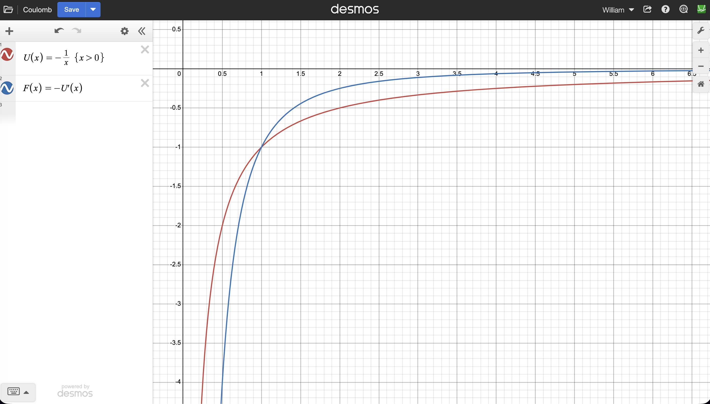

<nav class="packet-nav" aria-label="Packet navigation">
<a href="/aa/ss/2026-2027/">AA:SS class page</a>
<a href="/aa/assignments/x_astrodynamics_2.zip">Download assignment (.zip)</a>
<a href="/">Home</a>
</nav>

- Energy
    - Potential
    - Gravitational (Coulomb field)
    - Gravitational (uniform field)
    - Kinetic
    - Mechanical
- Conservation of energy
    - escape speed
    - Schwarzschild radius

In Astrodynamics Part 1, you learned how to apply Newton’s Laws in restricted astrophysical settings. In this packet, we will generalize some of these results and introduce a helpful new tool.

# Gravitational Potential Energy
Energy is an important physical concept that can be used in many situations instead of forces, and–when applicable–it is often much easier to use. The basic reason for this is that whereas the force $\vec{F}$ is a vector quantity, the energy is just an ordinary function.

Energy comes in very many forms, but the most important to us are the energy associated with motion and the energy associated with forces.

Potential energy is energy associated with interactions such as gravity. For gravity, the force points in the direction in which potential energy decreases. It is probably easiest to work directly with examples. The most relevant example for us is the magnitude of the gravitational force given by the LUG

$$
F_{g} = G\frac{m_{1}m_{2}}{r^{2}} \tag{1}
$$

The gravitational potential energy function associated with this is denoted by $U_{g}(r)$ and is given by

$$
U_{g}(r) = {- G}\frac{m_{1}m_{2}}{r} \tag{2}
$$

Note two important differences between formulae (1) and (2): There is a minus sign and the power of $r$ in the denominator is different.[1]

> ### Problem 1
>
> The SI units of energy are called **Joules** with a Joule denoted by the letter $J$. Determine the dimensions of energy and write the units of Joules in terms of fundamental SI units.

Note that the gravitational energy has the property that it goes to 0 if we separate the masses by an infinite distance. The minus sign, therefore, means that the energy gets lower as we reduce $r$. This is as we claimed: the gravitational force acts in a manner that reduces the potential energy.

How do we recover the force if we know the potential energy? We count outward as positive, so an inward gravitational force has a negative radial component $F_r$. The derivative $dU_g/dr$ is the local slope of the potential-energy graph. Below we will recover the magnitude in (1) from (2) using

$$
F_r=-\frac{dU_g}{dr} \tag{3}
$$

Ordinarily, we would need calculus to do this, but this time there is a very useful math trick we will use in Problem 2.

<figure style="max-width: 420px; margin: 1em auto;">
  
  <figcaption style="margin-top: 0.5em; font-size: 0.9em;">
    Figure: The gravitational potential $U_g(r)$ and the gravitational force $F_r=-{dU_g}/{dr}$ derived from it. The gravitational potential grows as you go further away from the center $r=0$. The force $F_r(r)$ is negative because it is pointing toward the center instead of to larger values of $r$. The size of the force decreases like $1/r^2$ as you go out. 
  </figcaption>
</figure>

> ### Problem 2
>
> Let $ε$ be a positive real number much much smaller than 1. We write this as $0 < ε ≪ 1$. The claim is that the infinite sum $1 + ε + ε^2 + ε^3 + ε^4 + ⋯$ is equal to the fraction $\frac 1{1-\varepsilon}$.
>   
> a. Set $ε = 0.1$ and calculate the decimal number you get from the first few terms in the sum $1 + ε + ε^2 + ε^3 + ε^4 + ⋯$. Calculate $\frac1{1-\varepsilon}$ as a decimal and compare to the sum. Which decimal are you changing if you include the next term in the sum?
>   
> b. Multiply both the infinite sum and the fractional expression by the quantity $(1 − ε)$ and expand out the product. What does this show?
>
> c. Use what you learned to give an infinite sum formula for the fraction $\frac1{1+\varepsilon}$. Explain what is happening with the signs.

Let’s use the results of this exercise to calculate $\Delta U/\Delta r$. When we move outward from a point $r$ to a nearby point $r + \Delta r$, the gravitational potential energy changes from $U_g(r)$ to $U_g(r + \Delta r)$, so the change in potential energy is $\Delta U_g = U_g(r + \Delta r) − U_g(r)$. Saying that the second point is nearby means that $\Delta r$ is very small compared to $r$, or $\Delta r \ll r$. Therefore, if $ε:=\frac{\Delta r}{r}$, then $0 <\frac{\Delta r}{r} \ll 1$, just as we required from $ε$ in problem 2.

Now we write

$$
U_g(r+\Delta r)=-G \frac {m_1m_2}{r+\Delta r}
=-G\frac {m_1m_2}r \frac1{1+\varepsilon}
=U_g(r)\frac1{1+\varepsilon}
$$

where $\varepsilon= \Delta r/r$. 

> The notation "$:=$" means "is defined to equal": here we define $\varepsilon$ to equal $\Delta r/r$.

Next, we expand in $\varepsilon$ using our result from problem 2:

$$
U_g(r+\Delta r)=-G\frac {m_1m_2}r \frac1{1+\varepsilon}
=U_g(r) \frac1{1+\varepsilon}
=U_g(r) \left[ 1-\varepsilon+ \varepsilon^2- \varepsilon^3+\dots \right]
$$

Thus $\Delta U_g(r)=U_g(r+\Delta r)-U_g(r)$ gives 

$$
\Delta U_g(r)=\Delta r\left(-\frac1r\right) U_g(r) \left[ 1-\varepsilon+\dots \right]
$$

So $\frac{\Delta U_g(r)}{\Delta r}$ is very nearly equal to $\left(-\frac1r\right) U_g(r)$ with the approximation getting better and better as $\varepsilon$ gets smaller and smaller. In fact, we can safely take $\varepsilon \to 0$ now and get an exact answer! This is the definition of the derivative that you will learn when you take (pre)calculus:

$$
\frac{d U_g(r)}{dr}=\lim_{\varepsilon\to 0} \frac{\Delta U_g(r)}{\Delta r}
\quad \quad (\textrm{derivative})
$$

and thus, we have derived that 

$$
\frac{d U_g(r)}{dr}=-\frac1r U_g(r)=+\frac1r G\frac{m_1m_2}r= G\frac{m_1m_2}{r^2}
$$

which is the size of the force $F_g(r)$. The negative of this slope gives $F_r=-Gm_1m_2/r^2$, as in formula (3). Its magnitude is the force in (1): We have recovered the gravitational force from the gravitational potential energy!

### An aside: 
The last piece to clean up has to do with the minus sign in the definition (3). The reason for it is that force is a vector which also has direction. In this case, we should imagine a large mass $M$ at the origin creating a *gravitational field* that falls off in magnitude as the distance from the origin grows. A small mass $m$ placed in this field has a potential energy 

$$
U_g = - m \frac{GM}{r}
$$

The gravitational force $\vec{F}_g$ on $m$ acts toward the origin: $U_g$ at large $r$ is *less negative* than $U_g$ near the origin. In general, a force could point in any direction, but in this case it is purely radial $\vec{F}_g = F_r \hat{r}$.
Here, we are using the common notation that $\hat{r}$ means the vector pointing radially outward from the origin with unit length. (It can also be written as $\hat{r}=\frac{\vec{r}}{r}$ since the RHS of this expression divides the radial vector by its length, so the ratio has length 1.) 
In any case, the radial component $F_r$ of the force must be negative for it to point inward, and it is for this reason that $F_r = -dU/dr$ instead of just $dU/dr$. 

> If you didn't follow this, don't worry! You may use derivative rules if you know them, but the problems below can also be approached using slopes and the algebra developed here. I show these things because they are really down-to-earth things that shouldn't be intimidating. If you want to learn more, just ask. If you didn't follow, but wish you could, just ask! 
>
> ### Optional practice problem (do this if you are afraid of having to take calc!):
> 
> a. Define the function $f(x)=x^2$ and use the method above together with the definition of the derivative

$$
\frac{df}{dx} =\lim_{\varepsilon \to 0} \frac{f(x+\varepsilon)-f(x)}{\varepsilon}
$$

> to calculate $\frac{df}{dx}$.
> The notation of the derivative as a "ratio" of $df$ and $dr$ is called [Leibniz notation](https://en.wikipedia.org/wiki/Leibniz's_notation). It's a bit cumbersome, and a popular shorthand for it is to denote it by a prime on the function $f^\prime=\frac{df}{dx}$. For some things the ratio version is handy and for others (like below) the prime is.  
> b. The [binomial formula](https://en.wikipedia.org/wiki/Binomial_theorem) implies that $(1+\varepsilon)^n=1+n\varepsilon+\dots$, where the ellipsis stands for "higher-order terms" which are terms that have higher powers of $\varepsilon$ (starting with terms proportional to $\varepsilon^2$). Use this to show that

$$
\frac{d}{dx}x^n =n x^{n-1}
$$

> c. For two functions $f(x)$ and $g(x)$ and two (real) numbers $\alpha,\beta\in {\bf R}$, show that

$$
\left(\alpha f+\beta g\right)^\prime=\alpha f'+\beta g'
$$

>
> **Congratulations!** You are now well on your way to acing your calc class...

> ### Problem 3
>
> We will calculate the gravitational potential energy of an apple of mass $m$ as a function of its height $h$ above the ground by using the fact that $0 <\frac{h}{R_{\oplus}} \ll 1$.
>
> a. Write $r = R_\oplus + h$ and plug it into the equation for the gravitational potential energy.
>
> b. Rewrite the denominator as $R_\oplus + h=R_\oplus\left(1+\frac h{R_\oplus}\right)$ and collect the terms $G\frac{mM_\oplus}{R_\oplus}$.
>
> c. Expand the factor of $\frac1{1+\frac h{R_\oplus}}$ keeping only the first two terms in $\varepsilon:=\frac h{R_\oplus}$.
>
> d. The first term is a constant $U_g(R_⊕)$ which we will argue to be unimportant, but the second term depends on the height $h$. Factor out $m$ from the coefficient of $h$. Identify the remaining factor using your previous packet, or first use dimensional analysis to determine what kind of quantity it is.
>
> e. Taking upward as positive, use the slope of your linear potential-energy function and rule (3) to calculate the vertical component of the gravitational force on the apple. State its magnitude and direction.

# Kinetic Energy
Kinetic energy is the energy of an object associated with its motion. It differs from the momentum (quantity of motion) in various ways. One is that it is a scalar function instead of a vector. 

> ### Problem 4
>
> Additionally, kinetic energy also has different dimensions (or units, if you like that better) than momentum.
>
> a. Using dimensional analysis and your result in problem 1, write a formula for the kinetic energy (called $K$) of an object of mass $m$ and speed $v$.
>
> b. Suppose you double the mass of a moving object, how does the kinetic energy change?
>
> c. Suppose you double the speed of a moving object, how does the kinetic energy change?
>
> d. The undetermined coefficient in your formula is equal to $\frac12$. Is it possible for the kinetic energy of an object to be negative? Rewrite your formula for $K$ so that it depends on mass $m$ and momentum $\vec{p}$ instead of speed.
>
> e. The dimensions of $K$ and $\vec{p}$ differ. By what kind of physical quantity would you have to multiply ${\bf p}$ to get something with the dimensions of $K$?

As we just learned, a very massive object that is moving–like a bowling ball or asteroid–will have a lot of energy. Even objects with very little mass can have a lot of kinetic energy if they are moving fast enough (like a bullet).

> ### Problem 5
>
> In the previous packet, you derived a formula for the speed of an object in circular orbit around the Earth (*e.g.* the ISS):

$$
v_{o}=\sqrt{\frac {GM}r}
$$

>
> a. The mass of the ISS is $450,000\ kg$; take its altitude to be $400\ km$. Use the formula for orbital speed to calculate the kinetic energy of the ISS.
>
> b. Redo this calculation without plugging in numbers to derive a formula relating the kinetic energy of an orbiting body to its gravitational potential energy. (Remember this result: It will come back very often in different guises during the AA course.)

# Mechanical Energy

The mechanical energy $E$ of a system is the sum of the kinetic energy $K=\frac12 mv^2$ and the potential energy $U$: 

$$
E=K+U(r)=\tfrac 12 mv^2 + U(r)
$$

When you take physics, you will learn a deep and wonderful fact about the way that Nature works: for the systems we study here, where gravity is the only relevant interaction and we neglect friction and air resistance, mechanical energy is **conserved**, which means it will have a constant value that does not change in time.

This is wonderful because even though the kinetic energy $K$ may change and the potential energy $U(r)$ may change, the sum of the two will not. Let’s see how this helps us in a typical physics example.

Adding a constant to potential energy changes neither its slope nor any difference in potential energy. We may therefore choose the zero of potential energy to suit the problem.

In problem 3d, you showed that for an object of mass $m$ a height $h$ above the ground, the gravitational potential energy is $U_g(h) = mgh$ where $g=\frac{GM_\oplus}{R_\oplus^2}$ is the usual surface gravity of $9.8\ m/s^2$. Now suppose we drop this object from rest. How fast is it going when it hits the ground? We will use the fact that the energy is conserved:  
The total mechanical energy when the object is at height $h$ must be equal to that at height 0. Since the object is dropped from height $h$ from rest, $v=0$ here:

$$
E_h=\frac12 mv^2+mgh=mgh \quad \quad \textrm{dropped from rest at height $h$.}
$$

Now, at height $h=0$

$$
E_0=\frac12 mv^2+mgh=E=\frac12 mv^2 \quad \quad \textrm{since $h=0$.}
$$

Conservation of energy means that these two energies need to be equal $E_h=E_0$, so

$$
\frac12 mv^2 = mgh \quad \Rightarrow \quad v^2 = 2gh
$$

The question was what the speed of the object is when it gets to the ground, so now we solve for $v$. The masses cancel out so all we had to do was multiply by 2. Now we take the square root: $v=\sqrt{2gh}$.

Note that the result above assumes that $h\ll R_\oplus$. We will generally be interested in systems where the only relevant force is the gravitational influence of a massive body, say of mass $M$. For general distances $r$ not bounded by $R_\oplus$, we need to go back to the general formula for the gravitational energy: 

$$
E=\frac12 mv^2-G\frac {mM}{r}  \tag{4}
$$

This energy is again constant, so we can play the same game we played in the example.

## Escape speed

If you throw a ball straight upward, it will slow to a stop, turn around, and come back down. If you throw it harder, it will go higher before it comes back down. If you throw even harder, it will go higher still. Is there a speed you can throw it so that it will not come back?

A ball with mass $m$ on Earth has some gravitational potential energy given by the formula (2) with $r=R_\oplus$ and the other mass equal to the Earth’s mass $M_\oplus$. If that same ball is moved infinitely far away from the Earth, it will have 0 gravitational potential energy. Instead of moving it out infinitely far away, we want to try to throw it there. 

If the ball launched from Earth with speed $v$, the total energy (4) must be the same when it is launched as when it arrives at infinity. When it arrives at infinity it may still have some excess speed, but the minimum initial speed that will get it there will have the ball arriving with no excess kinetic energy. That minimum initial speed is called the **escape speed** $v_e$: an object launched at that speed or faster will escape in this model, provided its path does not intersect the Earth.

> ### Problem 6
>
> a. Use conservation of energy to derive a formula for the escape speed from Earth. (We will ignore friction with the atmosphere in this problem.)
>
> b. Plug in the numbers to calculate the escape speed from Earth.
>
> c. Does it matter that this was a ball and the Earth, or can you generalize this result to anything launched off of anything else?
>
> d. Does it matter which direction you launch?

> ### Problem 7
>
> Calculate the escape speed for the Moon from the data in the table from problem 1 of the previous packet. Speculate on how the escape speed may be related to an astronomical body’s ability to retain an atmosphere.

> ### Problem 8
>
> In the previous packet, you worked out a formula for the **orbital speed** of an object in circular orbit around a primary.
>
> a. How is that orbital speed $v_o$ related to the escape speed $v_e$? Which one is bigger?
>
> b. Suppose a planet is in a circular orbit around a star of mass $M$ and for some reason the mass of the star suddenly drops to half its value $M_{new}=\frac12M_{old}$. Assume the mass loss gives the planet no impulse, so its position and velocity are unchanged at that instant, and neglect subsequent interaction with the expelled material. What happens to the planet?[2]

You may have heard that no object can move faster than the speed of light in vacuum. As we will learn when we talk about relativity in Advanced Astronomy: Universe, the speed of light in vacuum $c$ is a fundamental constant. Any inertial observer who measures this speed will find 

$$
c = 299,792,458\ \frac ms
$$

(or $c = 3.0 \times 10^8\ m/s$ among friends).

> ### Problem 9
>
> Now consider a star or some other very massive astronomical object with mass $M$ and radius $R$ and consider the escape speed $v_e=\sqrt{\frac{2GM}R}$ of an object launched from its surface.
>
> a. Notice that, for fixed mass, the Newtonian escape-speed expression increases as $R$ decreases. Find the radius $R_S$ at which this expression gives $v_e=c$. This is a Newtonian estimate of an important relativistic boundary: general relativity identifies the same radius as the event-horizon radius of a nonrotating, uncharged black hole.
>
> b. Calculate this radius for the Sun. 
>
> c. To what size do you need to squeeze down the entire Earth before light cannot escape its surface?
>
> d. Speculate about what would happen if it were possible to squeeze an object down to this radius.

The limiting radius you have found in problem 9 is called the **Schwarzschild radius**. For the nonrotating, uncharged case, if a mass is compressed within this radius, an event horizon forms: light emitted at or inside the horizon cannot escape to a distant observer. Since light cannot escape and nothing can travel faster than the speed of light, nothing can escape from such an object. Since light cannot escape, any light shone on it will not come back: this object is as black as logic itself allows. The existence of such a **black hole** was postulated as early as 1784 by [John Michell](https://en.wikipedia.org/wiki/John_Michell), 132 years before [Karl Schwarzschild](https://en.wikipedia.org/wiki/Karl_Schwarzschild) solved the Einstein equations analytically. However, as you can imagine after doing problems 9b and 9c, many people doubted the existence of such black holes.

[1] Actually, it is misleading to compare (1) and (2) since, as noted earlier, forces are vectors and equation (1) only gives the size of the force. In addition to the size, we need the direction, which–as we discussed in class–is from mass 1 to mass 2 or vice versa. On the other hand, the function (2) really is just a function with no direction associated with it.

[2] This isn’t as hypothetical as it sounds. In AA: Universe, we will study stellar evolution to find that some stars can shed a large fraction of their mass at the end of their lives.

