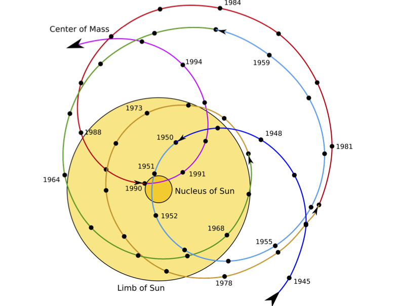
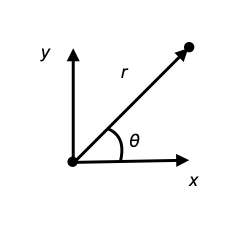
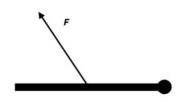
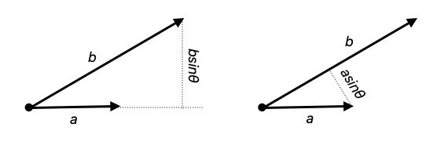

<nav class="packet-nav" aria-label="Packet navigation">
<a href="/aa/ss/2026-2027/">AA:SS class page</a>
<a href="/aa/assignments/x_astrodynamics_3.zip">Download assignment (.zip)</a>
<a href="/">Home</a>
</nav>

- Center of mass
- Reduced mass and reduction to the one-body problem

### WARNING:

This is not a look-it-up-type packet. Throughout this packet (and usually in these packets in general), I'm asking you to <u>think</u> and <u>build</u>. Of course you can just look up how everthing works and what the formulæ are. Looking it up defeats the purpose of doing these problems yourself. 

# The Two-body ~~Problem~~ Opportunity
We say that the Earth orbits the Sun and the Moon orbits the Earth, but what would happen if you had a star orbiting another star of the same size? If they are the same size, it would be nonsensical for one to sit still while the other orbits it. (This was precisely the logic Aristarchus was persuing when he said the Earth orbited the Sun and not the other way around.)

## Center of mass

Newton made a correction to Kepler’s First Law: What goes at the focus is not the primary body itself but the **center of mass** of the primary and secondary together. This center of mass is basically the correct generalization of the notion of average when the objects contribute different amounts. It's like your grade: It depends on formative assessments and summative ones, but the former count for $30\%$ and the latter by $70\%$, so we don't just add the scores. Instead we take an average weighted by these numbers. Suppose your formative score is denoted by $f$ and your summative by $s$. Then instead of grade $= \frac{1\times f+1\times s}2$, we calculate that it is $=\frac{30\times f+70 \times s}{30+70}$. In this analogy, the mass $M$ of the primary is the $70\%$, that $m$ of the secondary is $30\%$, and the total mass $M+m$ is $100\%$.

Now, suppose you have a very light (negligible mass) meter stick with a $1\ kg$ mass attached to each end. Then you expect the center of mass to be at the center. But if we have a $100\ kg$ mass at one end and a $1\ kg$ mass at the other, we expect the center of mass to be much closer to the $100\ kg$ mass.

> ### Problem 1
>
> Suppose you have two masses $m_1$ and $m_2$ attached to the ends of a very light stick of length $L$. Suppose we put coordinates $x$ on this stick so that $m_1$ is at $x=0$ and $m_2$ is at $x=L$.  
>
> a. Draw a picture of this situation.  
>
> b. Find an expression $x_{cm}$ that depends on $m_1$, $m_2$, and $L$ that has the following properties:
>    * $x_{cm} → 0$ if $L → 0$.
>    * $x_{cm} → 0$ if $m_2 → 0$.
>    * It has dimensions of length.
>    * $x_{cm} → L$ if $m_1 → 0$.
>    * $x_{cm} →\frac L2$ if $m_1$ and $m_2$ are equal.

In general, if two masses $m_1$ and $m_2$ are on a line with coordinates $x_1$ and $x_2$ respectively, then the **center of mass** or **barycenter** of the system is at

$$
x_{cm}=\frac 1M \left[m_1 x_1 + m_2 x_2\right] \tag{CM}
$$

where $M=m_1+m_2$ is the total mass of the system.

The structure of this formula is the following: The term in brackets does the “averaging” over the values of $x$ weighted by the mass: If there is no mass at some value of $x_*$ then the weight is 0 so there is no contribution to the sum there. Since $m_1$ is at $x_1$, we get a term $m_1 x_1$ for the first mass, and similarly for $m_2$ at $x_2$. The term in brackets has dimensions of mass times length, so to get something with dimensions of length, we need to divide by something with dimensions of mass. That thing will be the total mass $M=m_1 + m_2$. which is unbiased with respect to 1 and 2. Note that if $m_1 = m_2$, then 
$M=m_1+m_2$, and both masses contribute equally and the average reduces to the average of the position 

$$
x_{cm}\to \left[ \frac{ x_1+x_2 }{2} \right] = \frac L2 \tag{5}
$$

You should verify that equation (CM) reduces to what you found in Problem 1 when $x_1=0$ and $x_2=L$.

> ### Problem 2
>
> For the following pairs of astronomical bodies, calculate the center of mass. (You should look up any masses and distances you don’t already know.) For the first two, express your answer in terms of the radius of the primary.  
>
> a. Earth and Moon  
>
> b. Sun and Jupiter  
>
> c. [Sirius A and Sirius B](https://en.wikipedia.org/wiki/Sirius) when they are separated by 20 au.

<figure style="max-width: 420px; margin: 1em auto;">
  
  <figcaption style="margin-top: 0.5em; font-size: 0.9em;">
    Figure: The barycenter of the solar system over time. Can you tell when the planets came closest to alignment on one side of the Sun?
  </figcaption>
</figure>

## From one-body to two-body and back

Kepler’s Laws are correct in the so-called one-body approximation. In this approximation the Sun is not dynamical. Instead, it is fixed at the center $r=0$, and the planet that orbits it is the only dynamical object, ergo one-body.

In contrast to this, Newton treated the Sun as dynamical too, ergo a two-body problem instead of a one-body problem. In the two-body problem, there are two dynamical masses and one gravitational interaction between them. The conserved energy for this problem is

$$
E =\tfrac12 m_1v_1^2+\tfrac12 m_2v_2^2 -G\frac{m_1m_2}r \tag{6}
$$

It consists of a kinetic energy term for each mass $m_1$ and $m_2$ separated by a distance $r$ and the gravitational potential energy between them. Following Newton, we can rewrite this expression as follows:

$$
E =\tfrac12 MV^2+\tfrac12 mv^2 -G\frac{mM}r \tag{6'}
$$

In this expression, $v$ is the relative speed between the two masses, $M = m_1 + m_2$ is the total mass of the system, $V$ is the speed of the center of mass, and

$$
m= \frac {m_1m_2}{m_1+m_2}
$$

is a combination called the reduced mass. Expression (6’) says that the energy of the original system can interpreted as arising from two independent parts:

- First, there is the kinetic energy of the center of mass of the whole system given by $\frac12 MV^2$
- Second, we recognize $\frac12 mv^2 -G\frac{mM}r$ from equation (4) in `x_astrodynamics_2`. It is the total energy of the one-body system consisting of the secondary of mass $m$ orbiting a fixed primary with mass $M$.

Thus what we have found is that the two-body problem can be reinterpreted as a one-body problem by going to the rest frame of the center of mass!

> ### Problem 3
>
> In this optional problem we will derive equation (6’) from (6).  
>
> a. Firstly show that the gravitational potential terms agree by calculating the expression for $mM$ in terms of $m_1$ and $m_2$.  
>
> b. Write the center of mass coordinate as ${\bf R}=\frac1M\left[m_1 {\bf r}_1+m_2{\bf r}_2\right]$. This is the 3D version of equation (CM). Then the velocity of the center of mass ${\bf V}=\frac{d{\bf R}}{dt}$. Argue/show that this reduces to ${\bf V} =\frac1M\left[m_1 {\bf v}_1+m_2{\bf v}_2\right]$.  
>
> c. Show that $M^2 V^2= m_1^2v_1^2 + m_2^2v_2^2 + 2m_1m_2{\bf v}_1 \cdot {\bf v}_2$.  
>
> d. Show that $mMv^2= m_1m_2\left[ v_1^2 + v_2^2 - 2{\bf v}_1 \cdot {\bf v}_2 \right]$.  
>
> e. Use these expressions to calculate the sum of $MV^2$ and $mv^2$, and use that to show that equation (6’) follows from (6).

So what have we learned? The proper treatment of a gravitating system of two astronomical bodies should treat both as participating in the motion (two-body dynamics) instead of freezing the larger one in place and having only the second in motion (one-body dynamics in a central force). If we do this, we can switch from the coordinates of the two bodies of mass $m_1$ and $m_2$ to the barycenter position $\vec{R}$ and the relative position $\vec{r}=\vec{r}_1-\vec{r}_2$. The separation is $r=|\vec{r}|$, and the relative speed is $v=|d\vec{r}/dt|$. We then find that the energy separates into two parts: the center of mass energy $\frac12 M V^2$ has no dependence on the relative position or relative velocity. In particular, $v$ is not generally $dr/dt$: the separation can be constant while the relative speed is nonzero. The remaining part depends only on $r$ and $v$ but not on $R$ or $V$. Thus the problem separates into to different problems. The first is the apropriate to the free motion of a ficticious particle of mass $M$. The remaining part is exactly the one we discussed in `x_astrodynamics_2` which is the motion of a particle of mass $m$ in a central potential with a mass $M$ at $r=0$. 

Thus, we find that the problem can be reduced from the more complicated two-body problem to the simpler one-body problem, provided we make the following adjustments

- We move along with the system at its center of mass. Since that motion is free, that is an inertial frame of reference. In this case $R$ is constant to us and $V=0$. 
- Then what is fixed at the focus is a fictional body with mass $M = m_1 + m_2$ equal to the total mass of the system.
- What “orbits” is a fictional body with mass $m= \frac {m_1m_2}{m_1+m_2}$ equal to the reduced mass of the system.
- The distance $r$ between these fictional bodies is equal to the original distance between $m_1$ and $m_2$.

Although we will not do it here, a little more work shows how to take the solution of the motion of the reduced one-body system and translate it back to the original two-body problem:

- For an isolated bound pair, the original two bodies orbit their common center of mass in ellipses with semi-major axes $a_1$ and $a_2$. The semi-major axis of the ellipse of the reduced problem is related to these by $a = a_1 + a_2$.
- The eccentricities of all three ellipses (*i.e.* that of the primary, secondary, and reduced problem) are equal.
- The two original bodies orbit their center of mass with the same period. Both are equal to the period of the 1-body problem which was given by $\left(\frac{P}{2\pi}\right)^2 =\frac{a^3}{GM}$, but now $M = m_1 + m_2$ is the total mass of the system and $a = a_1 + a_2$ is the semi-major axis of the reduced problem.

> ### Problem 4
>
> In this problem, we will study a partcular solution to the 2-body problem.
>
> a. Pick a semimajor axis $a$ and eccentricity $\varepsilon$ and plot the solution. Here, plotting means doing it correctly and carefully, not just sketching. You can do this with pins, string, and rulers or with Desmos. The total mass $M$ should be at one focus and the ellipse should have radial coordinate $r$ from that focus. 
>
> b. What does this ellipse represent? Is is an orbit?
>
> We now want to understand what this solution means for the actual 2-body system. That is, we want the two orbits of $m_1$ and $m_2$ in the same plot (*i.e.* new drawing, but now with two orbits). We do this step-wise:
> 
> c. What does periapsis mean for the original 2-body problem? Label this point $r_p$. To what does apoapsis $r_a$ correspond? Calculate these values from what you learned in `x_astrodynamics_1`. Explain why it is inappropriate to call the point where $r=r_p$ perihelion or periastron (and similarly for $r=r_a$). 
>
> d. State what is true about the relative positions of $m_1$, $m_2$, and their barycenter $r=0$ at all times. In  other words, when $m_1$ is as some arbitrary point on its orbit, where is $m_2$ on the other orbit? Can you prove this statement? Hint: Think about the definition of the coordinate vector $\vec{R}$ of the center of mass.
> 
> e. Continue with this reasoning to derive that $a_1=\frac{m_2}{M}a$ and $a_2=\frac{m_1}{M}a$.
>
> f. Carefully plot the orbits of the two bodies $m_1$ and $m_2$ by drawing two ellipses with eccentricity $\varepsilon$ and semi-major axes $a_1$ and $a_2=a-a_1$. These ellipses should go through the points of part c. Where are $m_1$ and $m_2$ when the reduced mass $m$ is at periapsis and apoapsis?

## Modification to Kepler I and III

Recall that Kepler stated that the planets all revolve along an ellipse and that the Sun is at one of the foci of that ellipse. Newton's two-body treatment shows that, for an isolated bound pair, each body follows an ellipse with their common *barycenter* at a focus. In the Solar System, the gravitational effects of other bodies perturb these ideal two-body orbits. 

The new result also explains that the mass in the central force problem (originally $M_\odot$) should be replaced by total mass of the system. For the two-body problem,this means replacing $M_\odot\to M=M_1 + M_2$. This also means that Kepler III gets modified to 

$$
4\pi^2 \frac{a^3}{P^2}= G(M_1+M_2)
$$

where now, we interpret $a=a_1 + a_2$ as the semi-major axis of the reduced-mass part of the problem. 

# Angular Momentum

Consider a particle moving in a plane on say a table. That particle will have a well-defined position, velocity $\vec{v}$, and acceleration $\vec{a}$, all of which are time-dependent. 

In order to calculate anything, we may choose Cartesian coordinates $(x,y)$ to describe the position of the particle relative to an origin and some axes. Then the components of the velocity are given by the rate of change of these coordintes 

$$
\vec{v}=\pmatrix{ \frac{dx}{dt} \\ \frac{dy}{dt} }
\quad,\quad
\vec{a}=\frac{ d \vec{v} }{dt}
$$

Cartesian coordinates are nice for certain types of motion. They are particularly nice when the forces acting on a particle all lie on a single plane or a line. However, what if the particle is undergoing uniform circular motion around some point $\cal{O}$ in the plane. Then the distance from $\cal{O}$ to the particle is fixed at some value, and it is far more convenient to describe this motion in terms of (the non-Cartesian!) radial coordinates $(\rho, \theta)$ centered around $\cal{O}$. 

To do this, we make the coordinate transformation

$$
r=\sqrt{x^2+y^2}\quad, \quad \theta = \arctan\left(\frac {y}{x}\right)
$$

(being careful about which quadrant is which when taking the inverse of the tangent function). 
If we want to go the other way, we use the inverse transformation 

$$
x=r \cos\theta \quad, \quad y=r \sin \theta
$$

In uniform circular motion, the radial coordinate does not change in time and the angular coordinate progresses at a constant rate. It is difficult to overstate theoretical and practical importance of this type of motion. Applications range from the obvious like planetary motion with low eccentricity, wheels, gears, and clocks all the way into advanced mathematics. Because of this, it is useful to give the angular parts special names: we rename the **angular speed** $\omega$ and the (magnitude of the) **angular acceleration** $\alpha$:

$$
\omega = \frac{d\theta}{dt}
\quad, \quad
\alpha =\frac{d\omega}{dt}
$$

(I apologize for overloading $\alpha$, which was also, among other things, anglular size or parallax and the standard gravitational parameter).
Just as the mathematicians use $f'(x)$ as a shorthand for the derivative with respect to the variable $x$, physicists often use $\dot f(t)$ as shorthand for the derivative with respect to the time variable $t$. Thus, we may write 

$$
\omega = \dot \theta \quad, \quad \alpha= \dot \omega= \ddot \theta
$$

The angular speed $\omega$ is often called the **angular frequency**, because it has $[\omega]=T^{-1}$. If the motion is UCM with period $P$, then the object traverses $\Delta \theta=2\pi$ in time $\Delta t=P$, so the angular frequency is 

$$
\omega = \frac{2\pi}{P} \tag{UCM}
$$

The reciprocal of the period, $f=1/P$, is called the frequency. In terms of it, the angular frequency is $\omega =2\pi f$. 

> ### Problem 5
>
> Consider uniform circular motion around a point $\cal{O}$ in the plane.
>
> a. Draw a diagram of a point undergoing uniform circular motion. Introduce radial coordinates and use them to describe this motion. Be explicit in the choices you are making and why (*i.e.* identify the choices and justify them).
>
> b. Write equations for $\alpha$, $\omega$, and $\theta$ as functions of time $t$ or this motion. What is the distance the particle travels in a time $\Delta t$? 
>
> c. In the radial coordinates, the velocity $\vec{v}$ can be split into radial and angular parts $(v_r, v_\theta)$. Draw a typical velocity vector on your diagram and split it up into radial and angular components. (If you don't know what this means, ask!) Calculate the value of these components in terms of the coordinates $(r,\theta)$ and their derivatives $(\dot{r},\dot{\theta}=\omega)$. 
>
> d. What are the components of an acceleration vector in these coordinates?

Cartesian coordinates are nice when forces line up because then, some accelerations vanish and the corresponding components of the linear momentum $\vec{p}$ are constant. For really nice reasons having to do with the uniformity of Euclidean space, it turns out that the same thing is happening in the case of the angular motion. 

Recall that linear momentum was the term for Newton's concept of "quantity of motion". There is an analogous notion of "quantity of *angular* motion" that we call **angular momentum**. This quantity of motion is usually denoted $\vec{L}$, but other letters like $J$, $M$, and $S$ are also used. In complete analogy to Newton's first law, we have the "principle of conservation of angular momentum":

> *In an inertial frame of reference*, if no angular forces are acting on a rotating object, then angular momentum is conserved. 

In equation form,

$$
\frac{ d\vec{L} }{ dt } = 0
$$

It holds in an inertial frame for an isolated system, and this principle is just as powerful (if not more) as the conservation of linear momentum was. 

Just as there is a resistance to a change in *linear* motion given by the quantity of matter (inertial mass), so too is there a resistance to a change in circular motion we call **rotational inertia**; we will denote it by $I$. 

> ### Problem 6
>
> In this problem, we will consider an analogy between linear and angular kinematical variables. In this analogy linear coordinates are replaced by angular ones, linear velocity components are replaced by angular speed, mass $m$ is replaced by (rotational) inertial $I$, *etc*.
> 
> a. Consider the form of the (linear) momentum of a particle of mass $m$ and use it to propose a formula for the angular momentum of an object with (rotational) inertia $I$.
>
> b. Suppose an object has rotational inertia $I_1$ and angular speed $\omega_1$, but its inertia changes to $I_2$. From conservation of angular momentum and your result in a, derive a formula for the angular speed $\omega_2$ of the resulting motion. Does it matter whether the change in rotational inertia is gradual or not?
>
> c. What are the two ways you could force the angular momentum to change? Describe the form of the force that does one of these.
>

The consequences of the conservation of angular momentum are far-reaching, explaining a vast number of rotational phenomena from the functioning of machines to the morphology of hurricanes, star systems, and galaxies. 

If we are able to interact with a rotating object, we can change its rotational state and therefore its rotational inertia. For example, friction usually slows the motion of all objects to a stop. For a rigid system like a bicycle wheel, we can change the rotational speed with a chain attached to a gear on the wheel.  

The rotational analog of Newton II is: *In an inertial frame of reference*

$$
\vec{\tau}_{net}=\frac{ d\vec{L} }{ dt } \tag{1}
$$

Where $\vec{\tau}$ is a rotational analog of a force called **torque**. I like to think of it as the force of twisting. 

If you had a bicycle with multiple gears, you will have learned that it takes less effort to peddal with the biggest gear (on the back wheel!), but the wheel does not turn very fast. If you put the chain on the small gear (on the back wheel) then you can make the bike go really fast but it is much heavier work to pedal. We would say that for the same amount of tension in the chain, the larger gear provides a larger torque to the wheel. 

The gear is a mechanism to change a linear force (the tension in the bike chain) to a torque. Thus, we first need to get an idea of how a general linear force $\vec{F}$ that usually changes linear momentum $\vec{p}$ gets converted into an angular force $\vec{\tau}$ that changes the angular momentum $\vec{L}$.

> ### Problem 7
>
> Consider a heavy door that this free to rotate around its hinges. It is "free" in the sense that it has no spring mechanism to push the door shut so it is like an office door and not like an outer building door. Our door has fantastic hinges with very low friction but the door is really massive because it is large and made of some really nice dense wood. Consider applying a force $\vec{F}$ to the door with your hand: a push. We will assume the size $F$ is fixed. 
>
> a. Carefully describe where you would apply the force on the door and in which direction. For example, do you push on the middle of the door, closer to the hinge, or as far as possible from the hinge? Do you push toward the hinge, away from the hinge or in a direction orthogonal to the door?
>
 
>
> b. If you double the force you apply to the door but push at the same point and same direction, describe the what happens with the door. Since the inertia doesn't change, what happens to the angular momentum? Use the new Newton II for angular motion law (1) to guess what happens to the torque when you double the force.
>
> c. Is there a place on the door where you can push with with double the force but not cause a change in motion (*i.e.* with the door moving in the same way as with the original force in the original point). 

The hinge is an example of a *pivot*, the point around which things turn. The distance between where you apply the force and the pivot is called the *moment arm*. It is associated to the vector $\vec{r}$ pointing from the pivot to the point where force is applied, which can also be referred to as the moment arm. If you push a door directly in the direction toward/away from the pivot, nothing happens because the hinge mechanism pushes/pulls back. The only component of the force that is effective in the case of opening/closing a door is the part of the force *orthogonal* to the moment arm. This is often denoted $F_\perp$ ("eff-perp"), so $\tau\propto F_\perp$. Doubling the length $r$ of the moment arm also doubles the torque, so $\tau \propto rF_\perp$. If we denote the angle between the moment arm and the force vectors by $\theta$, then $F_\perp=F\sin\theta$ so $\tau \propto rF\sin\theta$. Actually, this *is* the magnitude of the torque:

$$
\tau = rF\sin\theta
$$

## Right-hand rule and cross product

Rotations happen in planes and around points. An object in uniform circular motion with frequency $\omega$ is orbiting a point we previously called $\cal{O}$ at a constant distance in a specific plane. In three-dimesional Euclidean space (and only there), there is a unique line $\ell$ through $\cal{O}$ orthogonal to the plane. We need Euclidean space to define this line because we need to define right angles. If our space had been two-dimensional, the plane would have existed, but this line $\ell$ would not have. Had the physical space we live in been four-dimensional then the line $\ell$ would not have been unique. (*E.g.* in 4D there would be an entire plane orthogonal to the orbital plane, but this is difficult to visualize.)

Coming back to UCM in our Euclidean 3D world, if we start at $\cal{O}$ and follow $\ell$ out to some distance, there would be two opposite directions we could go. For this reason, a line is not a vector. If there were some way to consistently pick out a preferred direction, we could use that to define a vector for the angular motion with angular speed $\omega$: we could define the **angular velocity** $\vec{\omega}$. This is such a convenient shortcut to use that most scientists think about rotations as happening around axes which  they describe with vectors. 

In general this is not correct, because rotations are more naturally identified with oriented areas. For example a "rotation around the $x$-axis by an angle $\theta$" is really a rotation in the $yz$-plane oriented from the $y$-direction toward the $z$-direction. Clearly, the axial rotation version is simpler to state and perhaps even think about. It's also easier to write, provided we can agree on which direction to pick along the $\ell$ line. 

Suppose we agree to pick the direction as follows: we start with the planar definition of rotation and rotate from $y$-direction to $z$-direction. We take our RIGHT HAND (not the other one) and point our fingers along the $y$-direction. We then curl our fingers toward the $z$-direction. If you make a fist, the back of your hand should lie along the $y$-direction. The phalanges attached to your hand should be parallel to the $z$-direction, the next phalanges are parallel to the $y$-direction again, and finally your finger tips are pointing in the direction opposite to the $z$-direction. Now, if you stick up your thumb, then it lies along $\ell$ and it points in a particular direction along $\ell$. The direction your thumb is pointing *defined* to be the $z$-direction and this assignment is called the right-hand rule. 

Similarly, if something is spinning, you can curl your fingers in the direction of the rotation. Then your thumb will point in the direction assigned to that spin. This gives a meaning to the angular velocity $\vec{\omega}$. It is the vector pointing in this direction with the magnitude $\omega$ defined to be the angular speed. 

The **cross product** is a mathematical and physical operation defined on two vectors that uses the right-hand rule and right angles. Because of this, it can only be defined for vectors in three-dimensional Euclidean space, but since that's were we live, we are free to use it. For two vectors $\vec{a}$ and $\vec{b}$, we define a third vector $\vec{c}=\vec{a}\times \vec{b}$ as follows: For the direction, use the right-hand rule as above but starting along the direction of $\vec{a}$ and curling fingers toward the direction of $\vec{b}$. Then the direction of $\vec{c}$ is the same as that of your thumb. The magnitude $c$ is the magnitude $a$ of the vector $\vec{a}$, but only that part of $\vec{b}$ *orthogonal* to $\vec{a}$. This works out to $c=ab\sin \theta$. Interestingly, the definition seems asymmetrical in $\vec{a}$ and $\vec{b}$ but it's not, for suppose we defined it to be the size $b$ times the orthogonal projection $a\sin \theta$. Then we would still get $c=ab\sin \theta$!

But wait! This is what we needed for the torque generated by a force $\vec{F}$ on a moment arm $\vec{r}$ above! This means that we can extend the torque to a vector and that there is a shorthand for it:

$$
\vec{\tau} = \vec{r} \times \vec{F}
$$

> ### Problem 8
>
> We finally have a definite form of a quantity of rotational dynamics!
> 
> a. Use it to determine the dimensions of torque, angular momentum, and rotational inertia. 
>
> b. Which important quantity shares the torque's dimensions? How do the two quantities differ? Are they similar in any sense?
>
> c. Use the dimensions of the angular momentum and the cross product to conjecture a formula for the angular momentum of a particle moving with linear momentum $\vec{p}$ around a pivot $\cal{O}$. Denote the vector from $\cal{O}$ to the postition of the particle by $\vec{r}$.
>
> d. Go back to equation (1) for the net torque and angular momentum, and consider it carefully in light of your new and explicit findings. Can you use your observations to pin down the proportionality constant in your formula from part c?
>
> e. Suppose a ball of mass $m$ is held a distance $r$ from a pivot by a rod with negigible mass. Use the results you have accumulated so far to propose a formula for the rotational inertia of such a ball and rod configuration. If you double the mass of the ball, what happens to the inertia? How about if you double the length of the rod instead?

In general, the rotational inertia of objects is not as simple as $I=mr^2$, but you can always break a complicated object into particles and add up all of the rotational inertiæ of those. This is one of the wonderful uses of the integration techniques you learn in calculus and its higher-dimensional versions. For example, a rod famously has a factor of $\frac{1}{12}$ if you spin it around the middle, but a factor of $\frac{1}{3}$ if you spin it around one end. There are also tricks to get from the rotational inertia around a particular pivot to another one like the "parallel axis theorem" in mechanics. 

The rotational inertia is usually quoted with respect to the center of mass. For a rod of mass $m$ and length $\ell$, the rod's inertia about its center of mass is $I_{rod}=\frac{1}{12}m\ell^2$. For a ball, $I_{ball}=\frac{2}{5}mR^2$, but for a sphere, it's $I_{sphere}=\frac{2}{3}mR^2$. These are all different because the mass is distributed differently in space. For example, for the sphere all the mass is as far away from the center of mass as the geometry will allow, whereas for the ball, much of it is close to the center and in between. This makes the sphere more resistant to a change of rotational motion than a ball of the same mass.
See this page for a [list of inertiæ](https://en.wikipedia.org/wiki/List_of_moments_of_inertia#Moments_of_inertia).

## Kepler's second law

Whew! That was a lot of new stuff, and it's probably TMI, but we can summarize everything now and use the results. For the most part, we can ignore the complications coming from the fact that we're back to vector quantities as long as we're ok with thinking qualitatively and inserting the odd factor of $\sin \theta$ by hand somewhere.

The salient points are

- The barycenter or center of mass is what really matters in astrodynamical problems. It often enjoys free motion.
- The two-body problem reduces to the central force problem in relative coordinates. It therefore has the same solutions, but you must know how to interpret them and translate back to 2-body geometry.
- There is a comlete analogy between kinematical quantities $\{x, v, a\}$ in Cartesian and $\{\theta, \omega, \alpha\}$ in radial coordinates, but one must be a bit careful with factors of $r$. 
- Torques are rotational forces that tend to spin things up and down.
- The resistance to a change of spin is called rotational inertia $I$. It has the same dimensions as $mr^2$ so it scales linearly with mass, but quadratically with size. The exact coefficient is $1$ for a particle but depends on the geometry in general. The general rule is that objects with stuff "on the outside" are harder to turn than objects with a compact distribution of matter: If you want to make rotational inerta small, pull it toward the center of rotation as much as possible. A ring or thin hollow cylinder have the largest ineria ($I=MR^2$) because all the matter is far from the axis of rotation. If you are doing for small inertia, a disk is better, and a compact ball is even better. 
- In the absence of torques or if the net torque vanishes, angular momentum is conserved.
- The most important formulæ are
    - CM radius: $r_{cm}=(m_1 r_1+m_2r_2)/(m_1+m_2)$ (and generalizations)
    - reduced mass: $m=m_1m_2/(m_1+m_2)$
    - those relating angular and linear variables such as $r\omega$ for tangential velocity in UCM.
    - rotational inertia: $I=c_0 MR^2$ where $c_0$ depends on the geometry of the object.
    - angular momentum: $L=I\omega$ (and sometimes $L=r_\perp p$)
    - torque: $\tau=I\alpha$ for constant rotational inertia about a fixed axis; the magnitude of the torque of a force is $r_\perp F$.
